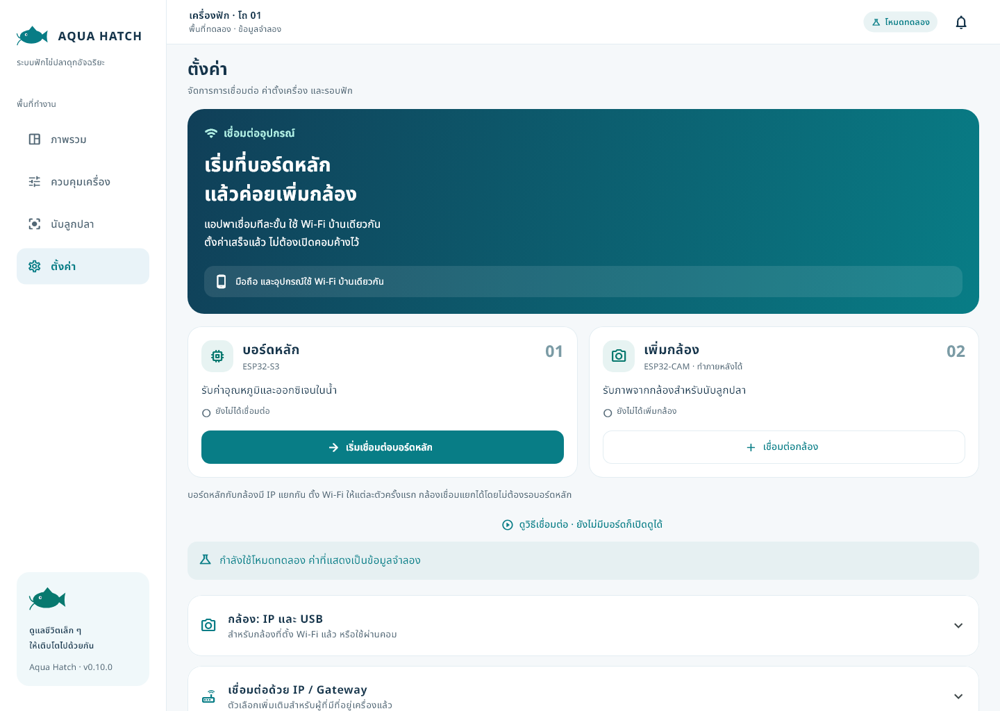

# AquaHatch — iOS / Android 0.12.0

อัปเดต 5 พฤศจิกายน 2026 · แอปดูสถานะเครื่องฟักไข่ปลา เชื่อม ESP32-S3 และ ESP32-CAM ผ่าน Wi-Fi บ้านโดยตรง อุปกรณ์แต่ละตัวมี IP แยกกัน

## เลือกระบบที่ใช้

| ระบบ | ชุดติดตั้งล่าสุด | วิธีติดตั้ง |
| --- | --- | --- |
| **iPhone / iOS** | [เปิดโฟลเดอร์ IOS](IOS/) · [ดาวน์โหลด IPA](https://github.com/Sivacxool/aquafish/raw/refs/heads/main/IOS/AquaHatch-v0.12.0-iOS-unsigned.ipa) | [คู่มือ iPhone](IOS/README.md) — IPA ยังไม่เซ็น ใช้ Sideloadly กับ Apple ID ของเจ้าของ |
| **Android / LDPlayer** | [เปิดโฟลเดอร์ ANDROID](ANDROID/) · [ดาวน์โหลด APK Universal](https://github.com/Sivacxool/aquafish/raw/refs/heads/main/ANDROID/AquaHatch-v0.12.0-Android-universal.apk) | [คู่มือ Android](ANDROID/README.md) — ARM32 / ARM64 / x86_64 |

ทั้งสองระบบเป็น **0.12.0+2013** และใช้ public CA กล้องชุดเดียวกันกับเฟิร์มแวร์ที่แก้ใบรับรองล่าสุด
ซอร์ส Flutter/Dart ใช้ร่วมกันใน [aqua_hatch](aqua_hatch/) โดยมี native project แยกใน [ios](aqua_hatch/ios/) และ [android](aqua_hatch/android/)

- [ดาวน์โหลดซอร์ส 0.12.0](AquaHatch-v0.12.0-source.zip)
- [ตรวจ SHA256 ของไฟล์ดาวน์โหลด](SHA256SUMS.txt)
- [ผลทดสอบและข้อจำกัด](VERIFICATION.md)

## สิ่งที่แก้ใน 0.12.0

- ใช้ OV3660 เป็นกล้องหลัก ถ่าย 2048×1536 ตามเซนเซอร์จริง พร้อมแฟลช
- แอปอ่านรุ่นกล้องและเลือกขนาดภาพ / การใช้ autofocus ให้ตรงรุ่น ยังรองรับ OV5640 และ OV2640 ในโค้ด แต่ยังไม่ได้สลับมาทดสอบฮาร์ดแวร์สองรุ่นนั้นซ้ำในรอบนี้
- หน้านับลูกปลาแสดงรุ่นและขนาดภาพจริง แตะหัวลูกปลาเพื่อนับด้วยมือได้ ปุ่ม AI ระบุว่ายังไม่พร้อมเมื่อเป็นภาพจากกล้องตรง เพราะยังไม่มีโมเดลที่ผ่านการยืนยัน
- เฟิร์มแวร์รองรับคำสั่ง 5mp ของแอปรุ่นเดิม โดยจำกัด OV3660 ที่ขนาด native 3MP เพื่อไม่ขยายภาพเทียม

- รองรับขั้นตอนเปลี่ยน Wi-Fi บน iPhone พร้อมคำอธิบายสิทธิ์เครือข่ายเฉพาะที่
- แก้ใบรับรอง ESP32-CAM เดิมที่มีอายุ 10 ปีซึ่ง Apple ปฏิเสธ ใช้ใบรับรองเซิร์ฟเวอร์ 730 วัน พร้อมตรวจชื่อกล้องและ CA ตามเดิม
- แอป iOS และ Android ชุดนี้ใช้ใบรับรองกล้องใหม่ตรงกัน ต้องใช้คู่กับเฟิร์มแวร์กล้องที่อัปเดตแล้ว รหัสจับคู่และ Wi-Fi ที่บันทึกในบอร์ดเดิมยังใช้ได้
- ปรับข้อความแจ้งปัญหาใบรับรองให้ระบุบอร์ดหรือกล้อง โดยไม่สรุปว่าเป็นอุปกรณ์คนละตัวเสมอ

ผู้ใช้เคยยืนยันเพิ่มกล้องบน iPhone ด้วยรุ่น 0.11.1 แล้ว รุ่น 0.12.0 เพิ่มการรองรับ OV3660; การถ่ายภาพบน iPhone หลังอัปเดตยังต้องยืนยันแยกต่างหาก

## เริ่มเชื่อมต่อ

เปิด **ตั้งค่า → เริ่มเชื่อมต่อบอร์ดหลัก** แล้วทำตาม **เตรียม → ต่อบอร์ด → เลือก Wi-Fi → ยืนยัน**
จากนั้นเพิ่มกล้องแยกในหน้าเดียวกัน ใช้รหัสจับคู่จากบัตรของอุปกรณ์แต่ละตัว

- [เริ่มใช้งานทีละขั้น](START_HERE_TH.md)
- [คู่มือ UI การเชื่อมต่อ](CONNECTION_UI_TH.md)
- [DS18B20 / DO และสายเซนเซอร์](aqua_hatch/SENSORS_SETUP_TH.md)
- [กล้อง OV3660 และแฟลช](AquaHatch-Camera-Start-TH.md)
- [สร้างชุดสำหรับบอร์ดใหม่ / ต่ออายุใบรับรอง](REBUILD.md)
- [กล่องควบคุมสำหรับพิมพ์ 3D](AquaHatch_CTRL-LV01_3D_Print_Pack.zip)

ยังไม่มีบอร์ดก็เปิด **ดูวิธีเชื่อมต่อ** เพื่อดูตัวอย่างและแอนิเมชันได้ โดยไม่เปลี่ยนการจับคู่หรือส่งคำขอไปอุปกรณ์
ตัวเลือก IP / Gateway / USB อยู่ในส่วนเพิ่มเติมแบบพับเก็บ

## ฮาร์ดแวร์และขอบเขตที่ทดสอบ

| ส่วน | สถานะ |
| --- | --- |
| ESP32-S3 | DS18B20 ที่ GPIO4 และ DO RS485 ที่ TX16 / DE17 / RX18; เคยตรวจการสื่อสารกับ Android ในรอบ 0.9.0 |
| ESP32-CAM | AI Thinker ESP32-CAM + OV3660 เฟิร์มแวร์ 0.12.0-camera.1; ตรวจ HTTPS และรหัสจับคู่เดิมผ่าน |
| การส่งภาพ | OV3660 รับภาพใหม่ 2048×1536 พร้อมแฟลชผ่าน HTTPS และโค้ด Dart ของแอป |
| iPhone | รุ่น 0.11.1 เคยเพิ่มกล้องสำเร็จ; ผลตรวจ 0.12.0 ดู VERIFICATION.md |
| โฟกัส | OV3660 ไม่ใช้ตัวช่วย AF ของ OV5640; ความคมของภาพลูกปลายังต้องทดสอบจริง |
| รีเลย์ / ปั๊ม / ฮีตเตอร์ | ยังไม่เปิดการขับโหลด; hardware_control / hardware_ready คง false |
| AI นับลูกปลา | ยังไม่มีโมเดลที่ยืนยันกับข้อมูลลูกปลาจริงในชุดนี้ |

การแก้ใบรับรองครั้งนี้ทำกับกล้องที่ต่ออยู่เท่านั้น บอร์ดหลัก S3 ที่ยังใช้ใบรับรองเซิร์ฟเวอร์ 10 ปีต้องต่ออายุแยกก่อนใช้กับ iOS
การสื่อสาร DO สำเร็จยังไม่ยืนยันการสอบเทียบ

## โค้ดหลัก

- [หน้าการเชื่อมต่อ](aqua_hatch/lib/features/connection_overview.dart)
- [ขั้นตอนและแอนิเมชัน](aqua_hatch/lib/features/connection_journey.dart)
- [ตั้ง Wi-Fi จากแอป](aqua_hatch/lib/features/wifi_setup.dart)
- [ติดต่อ ESP32-S3](aqua_hatch/lib/core/esp32_repository.dart)
- [รับภาพจากกล้อง](aqua_hatch/lib/core/direct_camera.dart)
- [เฟิร์มแวร์ S3](aqua_hatch/firmware/local_server/local_server.ino)
- [เฟิร์มแวร์กล้อง](aqua_hatch/firmware/camera_server/camera_server.ino)

บอร์ดใหม่ต้องสร้างเอกลักษณ์และคู่ใบรับรองส่วนตัว แล้วบิลด์แอปกับเฟิร์มแวร์ให้ตรงกันตาม [REBUILD.md](REBUILD.md)
รหัส Wi-Fi, token จับคู่จริง, private key, กุญแจเซ็นแอป และภาพจากกล้องจริงไม่รวมในชุดเผยแพร่
